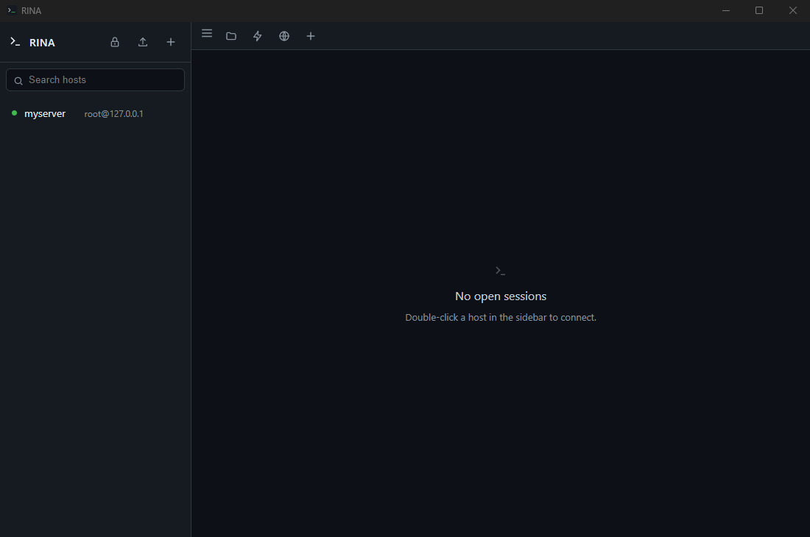
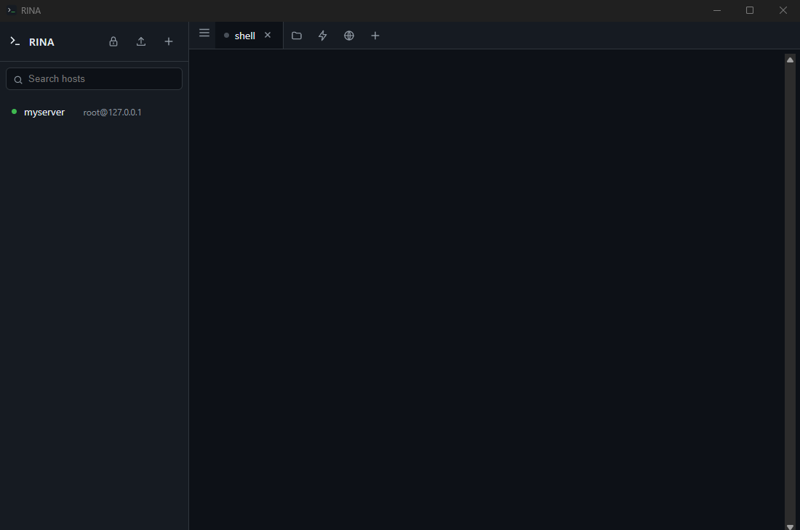
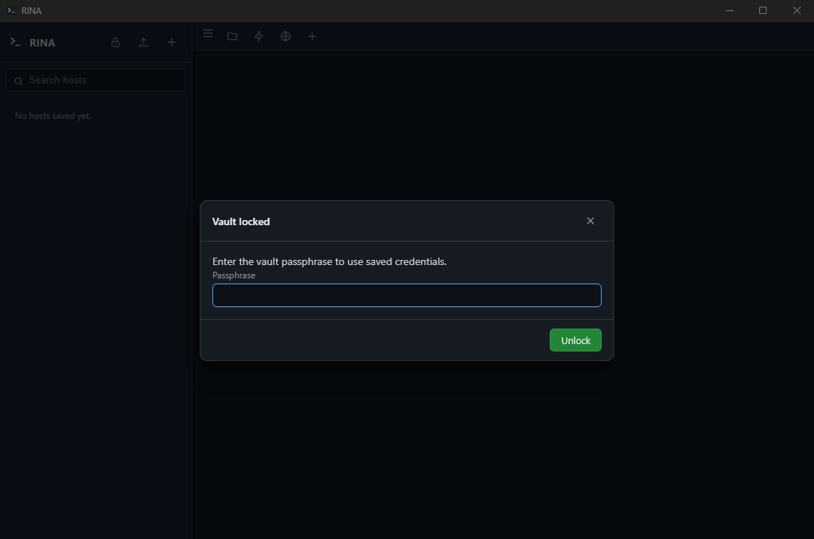
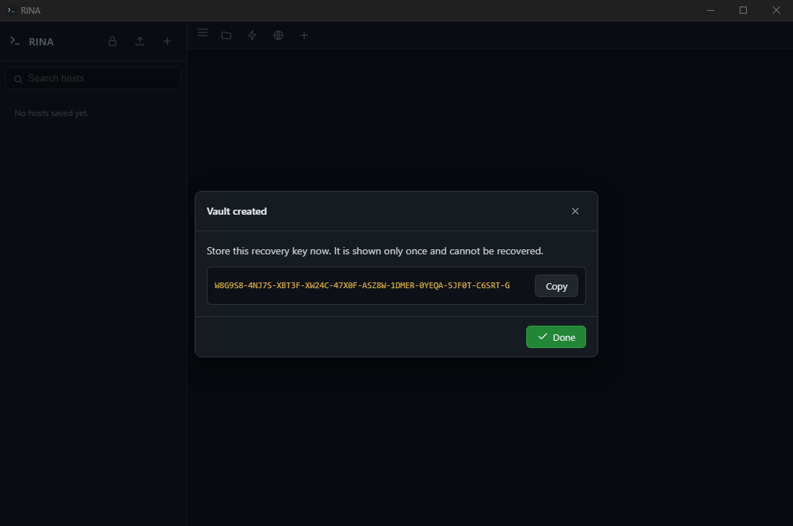

# RINA

**R**emote **I**nteractive **N**etwork **A**ccess

Desktop SSH client lintas-platform dengan terminal multi-tab, SFTP, vault kredensial terenkripsi, dan sinkronisasi opsional end-to-end ke server sendiri. Dibangun dengan **Rust** (Tauri 2, russh, rusqlite, Axum) dan **React + TypeScript** (xterm.js).

---

## Tampilan



Membuka tab terminal (workspace shell lokal, siap menerima PTY sesi SSH):



Saat startup, jika vault sudah ada, RINA meminta passphrase sebelum kredensial bisa dipakai:



Saat vault dibuat, recovery key ditampilkan sekali:



---

## Arsitektur

Workspace Rust dengan empat crate plus frontend:

```
RINA/
├── crates/
│   ├── core/          model data, SQLite, vault & kripto, import ssh_config
│   ├── ssh/           koneksi russh, auth, PTY shell, SFTP, key generation
│   ├── sync/          tipe protokol sync, envelope enkripsi record
│   └── sync-server/   Axum + PostgreSQL, server self-host
├── apps/rina/
│   ├── src/           React + TypeScript + xterm.js (UI)
│   └── src-tauri/     Tauri commands, state, bridge SSH ↔ UI, sync client
└── docs/img/          screenshot
```

Pemisahan lapisan:

| Lapisan | Teknologi | Peran |
|---|---|---|
| UI | React 19 + TypeScript + Vite + zustand | render terminal, sidebar host, dialog, SFTP panel |
| Terminal | xterm.js + WebGL + fit/search addon | emulator PTY di webview |
| Shell | Tauri 2 | IPC type-safe, event stream, manage state |
| SSH | russh 0.65 (pure Rust async) + russh-sftp 4 | handshake, auth, channel, SFTP |
| Data | rusqlite (bundled SQLite) | host, grup, credential, snippet, known_hosts, meta |
| Kripto | Argon2id + HKDF-SHA256 + XChaCha20-Poly1305 | vault & enkripsi record |
| Server | Axum 0.8 + sqlx/Postgres + JWT + Argon2id | sync zero-knowledge (opsional) |

Frontend tidak pernah memegang koneksi SSH. Frontend hanya mengirim input dan merender byte yang dikirim backend lewat event Tauri.

---

## Alur data

### 1. Terminal SSH (alur utama)

```
xterm.js (webview)
    │  invoke("session_write", {sessionId, data})
    ▼
Tauri command (Rust)
    │  shell.write(bytes)
    ▼
russh channel (PTY remote)
    │
    ▼ server menjalankan shell
russh channel
    │  emit("session-output", {sessionId, data: Vec<u8>})
    ▼
Tauri event
    │  TextDecoder → terminal.write()
    ▼
xterm.js
```

Ketika koneksi dibuka:
1. `connect_host(hostId)` mencari host di SQLite, resolve kredensial dari vault (dekripsi dengan DEK), lalu `rina_ssh::connect`.
2. `check_server_key` (russh Handler) memeriksa TOFU: kunci baru → dialog konfirmasi, kunci berubah → dialog peringatan dengan opsi tolak sebagai default.
3. Autentikasi: password / private key (+passphrase) / ssh-agent / keyboard-interactive (2FA).
4. `open_shell` membuka PTY, split channel menjadi dua task: writer (keystroke, resize) dan reader (output) agar output berat tidak memblokir input.
5. `ShellHandle` disimpan di `SessionMap` state; UI menampilkan pane terminal per tab.

`window-change` diteruskan lewat `session_resize`, sehingga ukuran terminal remote mengikuti ukuran pane.

### 2. Vault dan kredensial

```
master password
   │ Argon2id(salt, 64 MiB, t=3, p=4)
   ▼
master key (MK)  ──HKDF("vera/enc/v1")──► KEK    → wrap DEK
                 ──HKDF("vera/auth/v1")──► auth key (bukti ke server sync)
DEK acak 32 B  ──XChaCha20-Poly1305──► enkripsi setiap credential (AAD = credential id)
recovery key acak 32 B ──► wrap DEK cadangan
```

- `wrapped_dek`, `wrapped_dek_recovery`, `kdf_salt`, `kdf` disimpan di SQLite; **master password tidak pernah disimpan**.
- `vault_unlock` menurunkan KEK dan membuka DEK; `VaultHandle` menyimpan DEK di memori. `vault_lock` menghapusnya (zeroize saat drop).
- `host_save` dengan `secret` membuat credential terenkripsi lebih dulu, lalu menandai host dengan `credential_id`.
- Ganti master password = re-wrap DEK saja; record tidak dienkripsi ulang.

### 3. SFTP

`SftpClient::open` membuka subsystem `sftp` pada koneksi SSH yang sudah ada. Setiap perintah (`list`, `download`, `upload`, `mkdir`, `delete`, `rename`, `chmod`) membuka channel SFTP baru dari handle koneksi yang dibagikan (`Arc<Handle>`). Upload mengirim byte konten file dari webview (bukan path lokal), download menulis ke folder Downloads.

### 4. Snippet & command palette

Snippet disimpan di SQLite dengan placeholder `{{nama}}`. Ctrl+K membuka panel: pilih snippet → isi placeholder → `snippet_run` mensubstitusi teks lalu menulis perintah + newline ke shell sesi aktif. `snippet_placeholders` memindai token secara deterministic (dedup, urutan kemunculan pertama).

### 5. Import ssh_config & port forwarding

- `ssh_config_import(path)` mem-parsing `~/.ssh/config` (Host, HostName, User, Port, IdentityFile, ProxyJump), mengabaikan pola wildcard, lalu upsert host ke DB.
- `forward_local` bind `127.0.0.1:listen_port`, setiap koneksi TCP diteruskan lewat `channel_open_direct_tcpip` ke target di sisi server; `forward_stop` membatalkan task accept loop via registry `ForwardMap`.

### 6. Sync zero-knowledge (opsional)

```
Klien                                   Server (Axum + Postgres)
──────                                   ─────────────────────────
DEK + RecordCrypto.seal(record JSON) ──► blob ciphertext + id, updated_at, deleted, seq
auth_hash = base64(HKDF(auth_key))   ──► disimpan sebagai Argon2id PHC hash
```

- Server **tidak pernah** menerima master password, master key, DEK, atau plaintext.
- `auth_hash` (bukan password) dikirim untuk register/login, lalu server menyimpannya sebagai hash Argon2id PHC.
- `pull` mengembalikan blob terenkripsi + metadata urutan; klien membuka dengan DEK.
- Konflik: last-write-wins berdasarkan `updated_at`; versi sama = idempotent. Delete = tombstone.
- Device management: JWT access token, refresh rotation, revoke device.
- Endpoint: `/api/v1/account/{register,login,refresh,password,recovery}`, `/api/v1/sync/{pull,push}`, `/api/v1/devices`.

---

## IPC contract

Frontend memanggil command Tauri dengan argumen camelCase; Rust menerima snake_case (auto-mapping Tauri v2).

| Command | Argumen | Hasil |
|---|---|---|
| `list_hosts` | — | `Host[]` |
| `host_save` | `input` (host + authKind/secret/passphrase) | `Host` |
| `host_delete` | `id` | unit |
| `vault_exists` / `vault_create` / `vault_unlock` / `vault_lock` | `password` | `bool` / `string` / `bool` / unit |
| `connect_host` | `hostId` | session id |
| `session_write` / `session_resize` / `disconnect` | `sessionId`, `data` / `cols`,`rows` | unit |
| `sftp_list` / `sftp_download` / `sftp_upload` / `sftp_*` | `sessionId`, `path`/`remotePath` | entries / unit |
| `snippet_list` / `snippet_run` / `snippet_placeholders` | `snippetId` / `sessionId`, `values` | snippet list / command string |
| `ssh_config_import` | `path` | `Host[]` |
| `forward_local` / `forward_stop` | `sessionId`, `listenPort`, `targetHost`, `targetPort` | unit |
| `sync_register` / `sync_login` / `sync_now` / `sync_status` | email, password / — | token / status |

Event backend → frontend: `session-output`, `session-closed`, `dialog-confirm`, `dialog-prompt`. Dialog dijawab lewat `dialog_resolve { token, value }`.

---

## Build & development

Prasyarat: Rust stable, Node.js ≥ 20, Tauri 2 system dependencies.

```bash
cargo build --workspace
cargo test --workspace
cd apps/rina && npm install && npx tsc -p tsconfig.json && npm run build
npm run tauri dev
npm run tauri build     # installer di target/release/bundle/
```

### Windows: quirk toolchain

Host ini memakai `x86_64-pc-windows-gnu` tanpa `dlltool`, jadi selalu build dengan target MSVC dan tambahkan MSYS2 binutils ke PATH untuk `windres`/`gcc` yang dipanggil `tauri-build`:

```bash
export PATH="/c/msys64/mingw64/bin:$PATH"
cargo build --workspace --target x86_64-pc-windows-msvc
```

Detail di [BUILDING.md](BUILDING.md).

---

## Status pengujian

Terverifikasi nyata di host ini:
- `cargo build --workspace` lulus; 29 test unit workspace lulus; `tsc` + `vite build` lulus.
- `npm run tauri build` menghasilkan `RINA_0.1.0_x64_en-US.msi` (6.4 MB).
- Uji GUI: create vault → recovery key → restart → unlock passphrase → save host → host muncul di sidebar.
- `crates/sync/tests/e2e_logic.rs`: 9 test lulus — ciphertext tanpa plaintext, DEK salah gagal, AAD binding, LWW, wire types.

Belum terverifikasi (tidak ada Docker/Postgres/sshd di host):
- Sync end-to-end melawan server Postgres hidup: `crates/sync-server/tests/e2e.rs` sudah ditulis, di-`ignore`, siap dijalankan dengan `DATABASE_URL` + server aktif.
- `crates/ssh/tests/openssh.rs`: 7 test lulus melawan server russh in-process — password auth sukses/gagal, shell echo dua arah, PTY resize, exit status 7, TOFU pin + reconnect tanpa prompt, dan SFTP write/read/list/rename/delete/mkdir/rmdir nyata. Bukan OpenSSH container (tidak ada Docker di host).

---

## Lisensi

All rights reserved. Lisensi belum dipilih.
